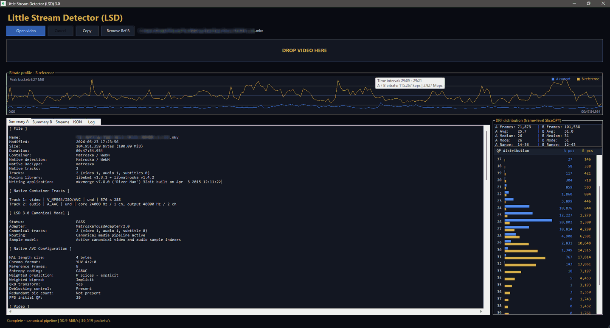

## Little Stream Detector (LSD)

Little Stream Detector (LSD) is a lightweight, portable video stream analyzer for Windows.

LSD performs native parsing of Matroska, WebM, MP4, M4V, MOV, and AVI containers together with native XviD, AVC/H.264, HEVC/H.265, VVC/H.266, AV1, AV2, VP8, and VP9 bitstream analysis. It provides frame-level QP/DRF statistics, quantizer distributions, GOP and frame-type analysis, bitrate profiles, stream metadata, and detailed diagnostic reports.

Version 3.0 adds direct comparison of a current encode against a saved reference. The application can display both bitrate profiles and compatible DRF/QP distributions in a shared view while preserving separate reports for the current file and the reference file.

LSD does not use FFmpeg, FFprobe, MediaInfo, or other external multimedia tools. Video files are read and analyzed without decoding, modification, or transcoding.

### Screenshot

## Available versions

- LSD.ps1
- LSD.exe
- LSD_mini.exe

There are currently three ways to use the tool:

PowerShell script

The original standalone PowerShell script. Its contents can be reviewed before execution, and it does not contain an executable wrapper.

IExpress package

The same PowerShell script packaged as an EXE using Microsoft IExpress. This version does not use MiniBuilder or the custom launcher. It currently produces the fewest antivirus detections in our testing, but uses the default IExpress icon.

Mini EXE

A compact executable of approximately 127 KB, created with MiniBuilder and our custom launcher. This version provides a custom EXE experience and includes our application icon, but it may trigger more heuristic antivirus detections.

All three versions perform the same basic task. The only differences are in packaging, appearance, and antivirus compatibility.

For maximum transparency, use the standalone PowerShell script. For convenient execution with fewer potential false positives, use the IExpress version. Choose the Mini EXE if you prefer the compact custom launcher and custom application appearance.

### Antivirus Notice

The compiled `.exe` is generated from the PowerShell source. Some antivirus engines, including Windows Defender or machine-learning-based scanners, may report a false positive.

The readable PowerShell source is included. If the executable is blocked, use `LSD.ps1` instead and review the source before running it.

### Running the PowerShell Source

If `LSD.ps1` was downloaded from the Internet, Windows may block it.

- Right-click `LSD.ps1`.
- Select **Properties**.
- Check **Unblock**.
- Click **Apply**.
- Start the script using **Run with PowerShell**.

Alternatively, unblock the downloaded ZIP archive before extracting it. This prevents extracted files from inheriting the Internet security marker.

### Download

Use the files from the latest 3.0 release:

- `LSD.exe` for normal use
- `LSD.ps1` as the readable PowerShell source
- the technical documentation for implementation details and supported analysis paths

No installation or administrator privileges are required.

### Usage

- Run `LSD.exe`, or start `LSD.ps1` with PowerShell.
- Drag a video file into the application window, or click **Open video**.
- Wait for the native analysis to complete. The loaded file is shown as **A Current** in blue.
- Click **Set Ref B** to store the current analysis as **B Reference** in gold.
- Load another file to compare the new **A Current** against the saved **B Reference**.
- Click **Remove Ref B** to remove the reference while keeping the current A result.
- Use **Summary A** and **Summary B** to review the reports independently.
- Move the pointer across the bitrate graph to display the selected time interval and the corresponding A/B bitrate values.
- Use **Copy** to copy the report from the active Summary tab.
- Open **Preview** to inspect A Current and B Reference in two independent muted preview panes.
- Click either pane to make it active. Ref A is highlighted in blue and Ref B in gold.
- Use **Left Arrow** and **Right Arrow** to move the active preview by one step on its own abstract axis. Press **Space** to toggle Play/Pause for the active pane.
- Use each preview axis independently. Source frame rate does not control preview stepping.
For meaningful visual comparison, A and B should represent corresponding versions of the same source. The user manually selects the pictures to compare.

### Manual Preview
  
The **Preview** tab provides two independent, muted panes for manual visual inspection:
- **Ref A** is shown with a blue active-state accent and follows A Current.
- **Ref B** is shown with a gold active-state accent and follows B Reference.
- One shared preview implementation creates two separate Windows media instances, each with its own source, position, controls, and abstract axis.
- The two axes advance independently and are not driven by the source video's reported frame rate.
- Click anywhere in a pane, including the displayed picture or black letterbox area, to select it for keyboard control.
- **Left Arrow** and **Right Arrow** move the selected pane by one axis step. **Space** toggles Play/Pause.
- The panes are not synchronized. There is no shared timeline, automatic offset, speed correction, or frame matching.
- If a source is missing or cannot be decoded by the Windows media pipeline, the pane displays **PREVIEW UNAVAILABLE**.
  
Preview is intentionally a **manual visual aid** and is separate from LSD's deterministic native analysis. LSD does not infer conversion history and does not assume that equal axis positions represent the same source picture. The user manually locates the pictures to compare. Analytical reports, bitrate profiles, parser results, and quantizer statistics remain independent of Preview.
  
Preview availability depends on the Windows media pipeline and installed system decoders. A file may therefore be analyzable by LSD while remaining unavailable in Preview.

### A Current and B Reference

LSD 3.0 uses a simple two-result model:

- **A Current** is the most recently analyzed file and is shown in blue.
- **B Reference** is the saved comparison result and is shown in gold.
- **Set Ref B** converts the current A result into the B reference.
- Loading another file creates a new A result while preserving B.
- **Remove Ref B** removes only B when A and B are present.
- Removing B when no A is present resets the interface to its startup state.

The comparison view includes:

- a shared bitrate profile using a common vertical scale
- an interactive time-and-bitrate tooltip
- blue A Current and gold B Reference legends
- compatible frame-level DRF/QP distribution comparison
- optional **Relative Q view** for A/B comparisons maps otherwise incompatible native quantizer metrics to separate codec-local 0–100% scales; it compares distribution shape, not equivalent visual quality
- separate **Summary A** and **Summary B** report tabs

### What's New in 3.0
- Added a **Manual Preview** tab with independent blue Ref A and gold Ref B preview panes.
- Added two independent abstract preview axes that are not driven by the source video's reported frame rate.
- Added per-pane Play/Pause, reset, step controls, axis sliders, active-pane keyboard control, and full-pane selection.
- Added a unified **PREVIEW UNAVAILABLE** state for missing or unsupported preview sources.
- Kept Preview deliberately unsynchronized: LSD does not estimate source-frame correspondence or conversion history.

- Added the **A Current / B Reference** comparison model.
- Added **Set Ref B** and **Remove Ref B** controls.
- Added simultaneous blue A and gold B bitrate profiles with a shared scale.
- Added a clear in-graph legend for A Current and B Reference.
- Added an interactive mouse-hover tooltip to the bitrate graph.
- Added time-interval and A/B bitrate reporting for individual bitrate buckets.
- Added comparative DRF, SliceQPY, AV1 Base Q Index, VP8 Base Q Index, VP9 Base Q Index, and MPEG-4 VOP quantizer distributions.
- Added a compact shared quantizer range from the lowest non-zero A/B value minus one to the highest non-zero A/B value plus one, clamped to the valid range of the active codec metric.
- Added side-by-side quantizer percentages for A and B.
- Added separate **Summary A** and **Summary B** views.
- Added automatic reset to the startup state when the last remaining reference is removed.
- Added native VP8 frame-header and Base Q Index analysis for Matroska/WebM.
- Added native VP9 uncompressed-frame-header and Base Q Index analysis.
- Added VP9 superframe detection and internal-frame traversal.
- Added VP9 hidden, shown, and show-existing frame accounting.
- Added VP9 support for Matroska/WebM and standard non-fragmented MP4/M4V/MOV through the `vp09` sample entry.
- Added AV1 multi-tile frame-header traversal for native frame-level Base Q Index analysis.
- Added expanded MPEG-4 Part 2/XviD analysis, including GMC/S-VOP handling.
- Added native fragmented MP4 sample indexing as an isolated MP4 sub-route using `mvex/trex` and `moof/traf/tfhd/tfdt/trun`.
- Added fragment-level resolution of sample offsets, sizes, durations, flags, DTS, PTS, and composition-time offsets.
- Reused the existing codec, audio, bitrate, tooltip, report, and A/B layers for fragmented MP4 after canonical samples are created.
- Preserved the existing conventional MP4 sample-table path without modification.
- Added codec-specific completeness and accounting validation for AV1, VP8, and VP9.
- Added first-failure and rejected-header diagnostics for the new native parser paths.
- Added native VVC/H.266 analysis using a two-pass **Collect -> Resolve -> Validate -> Publish** model.
- Added VVC Picture Header and Slice Header traversal, native I/P/B accounting, frame-level SliceQPY, and pixel-format derivation from SPS chroma format and bit depth.
- Consolidated common deterministic statistic calculations and histogram serialization without changing codec parser behavior.
- Preserved the native, container-independent canonical analysis pipeline introduced in version 2.0.
- No external multimedia tools or temporary files are required.

### Analysis Features

#### Containers

- Native Matroska and WebM parsing
- Native AVI 1.0 and OpenDML AVI 2.0 parsing
- Native standard MP4, M4V, and MOV parsing through conventional `moov` sample tables
- Native fragmented MP4 indexing through `mvex/trex` and `moof/traf/tfhd/tfdt/trun`
- Separate standard and fragmented MP4 sample-indexing branches with a shared canonical output model
- Native Matroska block and lacing processing
- Native MP4/MOV sample-table processing using `stsc`, `stsz`, `stco/co64`, `stts`, `ctts`, and `stss`
- Native AVI `idx1` and OpenDML `ix##` index processing
- 64-bit file-offset and bounded-sample validation

#### Video Analysis

- H.264/AVC analysis
- H.265/HEVC analysis
- H.266/VVC two-pass analysis for supported length-prefixed streams
- AV1 analysis, including multi-tile frame headers
- AV2 analysis with native two-pass OBU collection, frame-event resolution, and Base Q Index reporting
- VP8 analysis in Matroska/WebM
- VP9 analysis in Matroska/WebM and standard non-fragmented MP4/MOV
- MPEG-4 Part 2/XviD analysis, including GMC/S-VOP handling
- AVC configuration parsing from `avcC` and Annex B SPS/PPS discovery
- HEVC configuration parsing from `hvcC`
- VVC configuration and SPS/PPS context parsing from `vvcC`
- AV1 configuration parsing from `av1C`
- VP8 frame-tag and boolean-coded first-partition traversal
- VP9 uncompressed-frame-header and superframe traversal
- I/P/B, KEY/INTER, hidden, shown, and show-existing frame accounting where applicable
- Native frame-level AVC and HEVC SliceQPY analysis
- Native frame-level VVC SliceQPY analysis with complete-picture validation
- Native pixel-format reporting from codec chroma format and bit depth where available
- Native AV1, AV2, VP8, and VP9 Base Q Index analysis
- Native MPEG-4 Part 2 VOP quantizer analysis
- Quantizer distribution histograms and completeness validation

#### Audio Analysis

- AAC-LC, HE-AAC, and HE-AACv2 analysis
- MP3 frame analysis
- AC-3 and E-AC-3 syncframe analysis
- Signed integer and IEEE floating-point PCM analysis
- Sample-rate, channel-layout, payload, duration, and bitrate reporting
- Canonical audio sample accounting and first-failure reporting

#### Interface and Reports

- **Summary A**, **Summary B**, **Streams**, **JSON**, **Log**, and independent **Preview** views
- Comparative bitrate profile graph
- Interactive bitrate tooltip
- Comparative compatible quantizer distributions
- Drag-and-drop file selection
- Responsive background metadata preparation and analysis
- Explicit `N/A` reporting for unavailable or unsignaled values

### Fragmented MP4 Scope

The fragmented MP4 branch is designed for complete local files containing an initialization `moov` box and media fragments described by `moof/traf/tfhd/tfdt/trun`.

The first implementation resolves:

- per-track defaults from `trex`
- fragment and track selection from `moof/traf/tfhd`
- decode start time from `tfdt`
- explicit or inherited sample duration, size, and flags
- composition-time offsets from `trun`
- canonical file offsets, DTS, PTS, duration, and keyframe state

The branch reuses the existing codec and audio analyzers after canonical samples have been created. The conventional MP4 indexer remains a separate unchanged path.

### Known Limitations

- The fragmented MP4 branch supports standard unencrypted files containing an initialization moov box and media fragments described by moof, traf, tfhd, tfdt, and trun.
- Encrypted CENC samples and auxiliary encryption structures such as senc, saiz, and saio are not supported.
- Standalone media segments without an initialization moov box are not supported.
- Incomplete files that are still being written and live network streams are not supported.
- VP8 is supported only in Matroska/WebM. VP8 in MP4/MOV and AVI is intentionally not enabled.
- VP9 in AVI is not supported.
- AVI H.264/AVC support is intended for Annex B streams.
- AVI files containing AAC or E-AC-3 audio are not currently supported.
- Container-only color metadata, such as MP4 colr/nclx or Matroska Colour, is not currently used as a fallback.
- VVC results are published only after complete two-pass validation; unsupported VVC syntax paths are rejected rather than estimated.
- Preview is a manual visual aid and does not synchronize A and B automatically.
- Preview axes are independent and are not a source-time or source-frame identity model.
- Equal axis positions do not prove that two displayed pictures share the same source frame.
- Displayed pictures depend on the Windows media pipeline and installed system decoders.
- Files that cannot be decoded by the Windows media pipeline may still be analyzable by LSD but unavailable in Preview.
- Quantizer distributions are directly comparable only when A and B use the same quantizer metric.

### License

Little Stream Detector is licensed under the GNU General Public License v3.0.